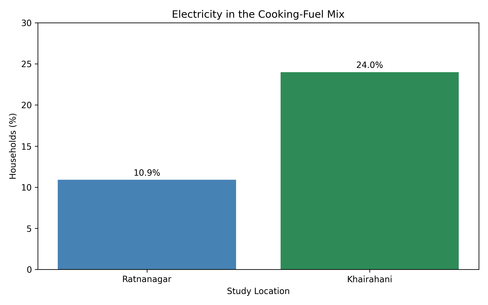

# Nepal Household Energy Research

## Research Overview

This project presents Python-based demonstrations of energy
calculations and data visualisation related to household
fuel stacking and electricity adoption in Chitwan, Nepal.

The associated study surveyed 201 households in two
semi-urban settlements: Ratnanagar and Khairahani.

## Research Objectives

- Examine household cooking-fuel choices.
- Compare electricity inclusion in cooking-fuel mixes.
- Estimate LPG fuel energy and useful cooking heat.
- Demonstrate scientific calculations using Python.

## Research Visualisation

### Electricity in the Cooking-Fuel Mix

The chart shows the percentage of surveyed households
reporting electricity in their cooking-fuel mix:

- Ratnanagar: 10.9%
- Khairahani: 24.0%

These values describe the surveyed households and do not
represent exclusive electric cooking.

## Python Files

- `energy_calculations.py` — Demonstration of LPG energy
conversion and useful-heat calculations.
- `electricity_comparison.py` — Creates the electricity
comparison graph using Matplotlib.

## Technologies

Python, Matplotlib

## Research Status

The associated manuscript is under journal consideration.
This repository contains reconstructed demonstration
scripts based on the study's reported methods and
aggregate findings, not the original complete analysis
pipeline or household-level survey dataset.

## Data Availability
The original household-level survey dataset is not publicly
available in this repository due to participant privacy,
research ethics, and data-sharing considerations.

This repository provides demonstration Python scripts
and visualisations based on aggregate research findings.

Requests for access to research data may be considered
subject to author approval, participant consent,
and applicable institutional requirements.

The household-level survey dataset is not publicly
included because sharing requires appropriate review
of consent, privacy, and institutional conditions.
